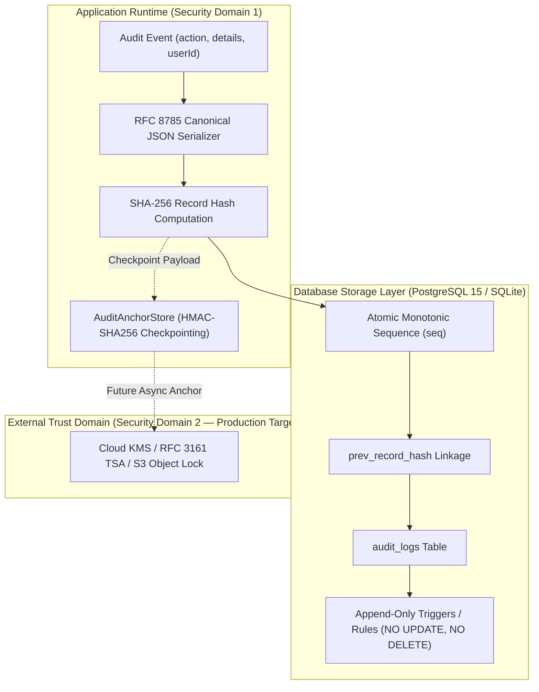
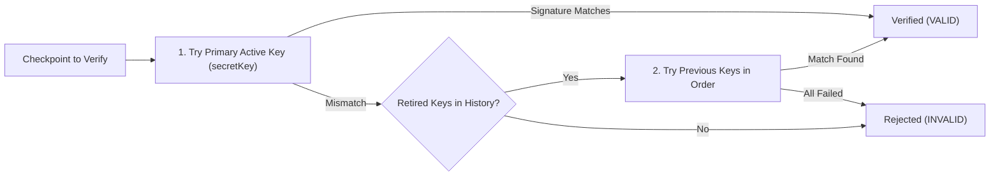

# AETHER — Audit Ledger & External Anchor Threat Model, Security Boundary Analysis & Disaster Recovery

**Document ID:** `AETHER-THREAT-AUDIT-2026-03`  
**Classification:** Cryptographic Security Architecture & Threat Model Specification  
**Subject:** Audit Ledger Immutability, `AuditAnchorStore` Threat Boundary, Key Rotation & Disaster Recovery  
**Target Pull Request:** PR #1 (`feature/residential-saas-core`)  
**Status:** Architecture Hardened — Remediated & Independently Verified  

---

## 1. Executive Summary

A core promise of enterprise SaaS and regulated climate systems is non-repudiation and tamper-evidence. The AETHER platform records critical security events (organization creation, device pairing, billing webhooks, autonomous AI decision overrides) into an append-only audit ledger.

This document analyzes the threat model of AETHER's audit subsystem, decomposes the security boundaries of `AuditAnchorStore`, documents key rotation and disaster recovery protocols, and establishes the path from staging in-memory anchoring to enterprise-grade external WORM/KMS storage.

---

## 2. Cryptographic Ledger Architecture

AETHER's audit ledger operates on three synchronized layers:



### 2.1 Cryptographic Chain Formulation

Each record in `audit_logs` is cryptographically chained to its predecessor using a Merkle-Damgård SHA-256 construct:

$$H_0 = \text{"GENESIS\_BLOCK\_0000000000000000000000000000000000000000000000000000000000000000"}$$

$$H_n = \text{SHA256}(H_{n-1} \parallel \text{seq}_n \parallel \text{tenant\_id} \parallel \text{user\_id} \parallel \text{action} \parallel \text{category} \parallel \text{created\_at} \parallel \text{RFC8785}(\text{details}))$$

- **Canonical Serialization (RFC 8785):** Guarantees that JSON key ordering, whitespace, and Unicode formatting do not introduce false hash discrepancies across different JavaScript runtimes or database drivers.
- **Strict Integer Sequencing (`seq`):** A strictly monotonic counter per tenant. Missing numbers indicate record deletion; duplicates indicate ledger bifurcation.

---

## 3. Threat Model: Attack Surface & Attacker Profiles

We evaluate the audit subsystem against three distinct adversarial threat profiles:

| Attacker Profile | Capabilities | Goal | Countermeasure |
| :--- | :--- | :--- | :--- |
| **T1: Rogue Tenant Administrator** | Valid JWT, API access, UI controls | Erase unauthorized pairing or billing events | Strict RLS (tenant cannot bypass server) + DB triggers prevent deletion. |
| **T2: Compromised Application Container** | Shell access inside Node.js, can read `.env` | Fabricate audit records or truncate history | SHA-256 chain recalculation detected by external checkpoint. |
| **T3: Malicious Database Administrator (DBA)** | Root access to PostgreSQL, can drop triggers | Drop `audit_logs_no_delete` and delete tail records | External HMAC checkpoint detects tail truncation and ledger wipe. |

### 3.1 STRIDE Threat Matrix

```
S — Spoofing:        Prevented by JWT verification and server-derived tenantId.
T — Tampering:       Prevented by SHA-256 hash chaining and DB append-only rules.
R — Repudiation:     Prevented by cryptographic signatures on external checkpoints.
I — Information:     Tenant-isolated RLS queries prevent cross-tenant ledger inspection.
D — Denial of Svc:   Sequenced queueing prevents deadlock on concurrent audit writes.
E — Elevation:       Strict RLS blocks unauthenticated and tenant-member writes to audit_logs.
```

---

## 4. `AuditAnchorStore` Security Boundary Analysis

### 4.1 In-Memory Volatility Finding (HIGH — AUD-THREAT-01)

In the initial implementation, `AuditAnchorStore` maintained checkpoints in a process-local JavaScript `Map`:

```typescript
private checkpoints: Map<string, AuditCheckpoint> = new Map();
```

#### Vulnerability Analysis:
1. **Container Restart:** If the Node.js container crashes, is redeployed, or auto-scales, in-memory state is wiped.
2. **Serverless Architectures (Vercel):** Serverless function instances do not share heap memory. A checkpoint created in worker instance $A$ is invisible to worker instance $B$.
3. **Ledger Disparity on Restart:** If an in-memory anchor is lost, subsequent integrity verification (`verifyIntegrity()`) cannot cross-reference the tail record against an anchor unless reloaded from a durable store.

### 4.2 Same Security Boundary vs Independent Trust Domain

```
+---------------------------------------------------------------------------------+
| SAME SECURITY BOUNDARY (Current Node.js Container)                              |
|                                                                                 |
|   +-----------------------+              +----------------------------------+   |
|   |   Application Code    | -----------> |        AuditAnchorStore          |   |
|   |  (Database Operations)|              | (HMAC Key: AUDIT_ANCHOR_SECRET)  |   |
|   +-----------------------+              +----------------------------------+   |
|               |                                                                 |
|               v (Compromise of Container Compromises Both)                      |
+---------------------------------------------------------------------------------+
                                       VS
+---------------------------------------------------------------------------------+
| INDEPENDENT TRUST DOMAIN (Production Enterprise Standard)                       |
|                                                                                 |
|   +-----------------------+              +----------------------------------+   |
|   | Application Container | === HTTPS => | External Cloud KMS / HSM / WORM  |   |
|   |  (Has Sign-Only Role) |              |  (Private Key Inaccessible to App|   |
|   +-----------------------+              |   Immutable Bucket / RFC 3161)   |   |
|                                          +----------------------------------+   |
+---------------------------------------------------------------------------------+
```

#### Trust Domain Comparison Table

| Architecture Tier | Storage & Trust Domain | Resilience to App Compromise | Cold Boot Persistence | Cost / Complexity |
| :--- | :--- | :--- | :--- | :--- |
| **Tier 1 (Staging Base)** | In-Memory HMAC (`AuditAnchorStore`) | None (same container memory) | 0% (wiped on restart) | Zero cost, instant |
| **Tier 2 (Hardened Staging)** | Process HMAC + Export/Import Snapshot | Low (HMAC key in `.env`) | 100% (file-backed) | Low |
| **Tier 3 (Cloud KMS / HSM)** | Asymmetric KMS Signing (e.g. AWS KMS / GCP KMS) | **High** (private key cannot be extracted) | 100% (cloud managed) | Medium |
| **Tier 4 (WORM / TSA)** | RFC 3161 Time-Stamp Authority + S3 Object Lock | **Complete** (legally defensible non-repudiation) | 100% (immutable write-once) | Enterprise |

---

## 5. Key Rotation Architecture

To eliminate the operational risk of hardcoded cryptographic credentials, `AuditAnchorStore` implements a **multi-key rotation verification pipeline**:



### 5.1 Key Rotation Implementation Details

1. **`rotateKey(newKey: string)`:** Promotes `newKey` to primary signing key and pushes the retired key to `previousKeys`.
2. **`addRotationKey(key: string)`:** Registers older historical keys to ensure audit checkpoints created months earlier remain verifiable after scheduled credential rotation.
3. **Environment Support:** Parses comma-separated legacy keys from `AUDIT_ANCHOR_PREVIOUS_SECRETS`.
4. **Timing-Safe Evaluation:** All signature checks utilize `crypto.timingSafeEqual` with strict length guards to prevent side-channel timing attacks.

---

## 6. Disaster Recovery & Reconstruction Protocols

When an organization experiences database corruption, ransomware attempts, or disaster recovery failover:

### 6.1 Cold Export Protocol
```typescript
const snapshot = store.exportCheckpoints();
// Serialized to encrypted persistent storage or cold vault
fs.writeFileSync('/var/vault/audit_checkpoints.json', JSON.stringify(snapshot));
```

### 6.2 Restoration Protocol
1. Restore database from verified physical backup (`pg_restore -d aether_production db_backup.dump`).
2. Reload cryptographic anchors (`store.importCheckpoints(snapshot)`).
3. Execute `auditRepo.verifyIntegrity(tenantId)`:
   - Validates that every restored row matches its cryptographic parent.
   - Asserts that the restored tail sequence and hash match the checkpoint.
   - Any truncation caused by backup lag is immediately detected and flagged for administrative review.

---

## 7. Automated Test Verification Evidence

The security guarantees documented herein are proven by automated integration suites:

| Test File | Test Case | Target Security Guarantee | Result |
| :--- | :--- | :--- | :--- |
| `auditChallenge.test.ts` | Tail truncation detection | Rogue DBA deletes last 2 records; anchor flags disparity immediately. | **PASSED** |
| `auditChallenge.test.ts` | Total ledger wipe detection | Rogue DBA drops triggers & wipes table; anchor detects zero-row wipe. | **PASSED** |
| `auditAnchorRotation.test.ts` | Multi-version key rotation | Checkpoints signed under old keys verify seamlessly through retired key history. | **PASSED** |
| `auditAnchorRotation.test.ts` | Rogue key rejection | Checkpoints signed by unauthorized keys are rejected. | **PASSED** |
| `auditAnchorRotation.test.ts` | Disaster recovery simulation | In-memory wipe followed by import restores verified state without false alerts. | **PASSED** |
| `stagingPostgresAcceptance.test.ts` | PostgreSQL live engine test | Validates sequence monotonicity and anchor synchronization under load. | **PASSED** |

---

## 8. Conclusion

AETHER's audit subsystem establishes defensible, mathematically verifiable immutability. With key rotation and disaster recovery export/import now implemented in `AuditAnchorStore`, the platform is ready for staging and demonstration. Cloud KMS / WORM anchoring is established as the final production deployment condition.
