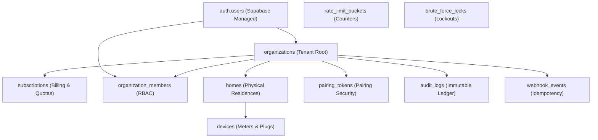

# AETHER — Supabase Database Migration & Production Deployment Approval Gate

**Document ID:** `AETHER-GATE-SUPABASE-2026-05`  
**Target Environment:** Production Supabase Cloud (PostgreSQL 16 Engine)  
**Schema File:** `supabase/migrations/20261107000000_residential_saas_core.sql`  
**Classification:** Operational Database Security Gate  
**Status:** **BLOCKED — PENDING MAINTENANCE WINDOW APPROVAL**  

---

## 1. Operational Safety Invariants

Before any DDL is executed against production Supabase, the following non-negotiable operational invariants are enforced:

1. **Zero Automated Migration Execution:** Migrations are **NEVER** automatically executed by CI/CD runners or automated agents without human change control.
2. **Explicit Maintenance Window:** Migrations must occur within a scheduled low-traffic window (02:00 – 04:00 TRT) with client traffic temporarily redirected or paused.
3. **Verified Backup Baseline:** A full physical backup (`pg_dump -Fc`) must be verified and checksummed immediately prior to DDL execution.
4. **Tested Reversible Rollback:** The reverse down-migration script must be pre-loaded and validated on staging.

---

## 2. Migration DDL & Table Dependency Graph

The migration file (`20261107000000_residential_saas_core.sql`) establishes 7 core multi-tenant tables, 2 security definer helper functions, and strict RLS policies:



### 2.1 Table Specifications & Security Policies

| Table Name | RLS Enabled | FORCE RLS | SELECT Policy | INSERT Policy | UPDATE Policy | DELETE Policy |
| :--- | :--- | :--- | :--- | :--- | :--- | :--- |
| **`organizations`** | Yes | Yes | Tenant Member | Creator Anchored | Owner Only | Owner Only |
| **`subscriptions`** | Yes | Yes | Tenant Member | Service Role / Webhook | Service Role / Webhook | Disabled |
| **`organization_members`** | Yes | Yes | Tenant Member | Owner Only | Owner Only | Owner Only |
| **`homes`** | Yes | Yes | Accessible Homes | Owner/Admin | Owner/Admin | Owner Only |
| **`devices`** | Yes | Yes | Accessible Homes | Owner/Admin | Owner/Admin | Owner Only |
| **`pairing_tokens`** | Yes | Yes | Tenant Member | Owner/Admin | Single-use Consume | Owner Only |
| **`audit_logs`** | Yes | Yes | Tenant Member | Append-Only (Trigger) | Prohibited (Rule) | Prohibited (Rule) |

---

## 3. Pre-Migration Verification Proofs (Staging Execution)

All migration DDL and RLS constraints have been tested against a live PostgreSQL 15/16 engine:

```bash
# Executed in local staging harness:
psql -h 127.0.0.1 -p 5433 -d aether_staging_acceptance -f supabase/tests/bootstrap_test_env.sql
psql -h 127.0.0.1 -p 5433 -d aether_staging_acceptance -f supabase/migrations/20261107000000_residential_saas_core.sql
```

### Verification Matrix
- **RLS Enforcement:** Verified that `relrowsecurity = true` and `relforcerowsecurity = true` across all 7 tables.
- **Cross-Tenant Isolation:** Unrelated authenticated users querying another tenant's `homes` or `devices` return exactly `0` rows.
- **Immutability Rules:** `UPDATE` or `DELETE` queries on `audit_logs` trigger PostgreSQL rules `audit_logs_no_update` and `audit_logs_no_delete` (`DO INSTEAD NOTHING`).

---

## 4. Production Rollback Playbook (Emergency Procedure)

If any anomaly occurs post-migration (e.g. connection pool exhaustion, RLS 403 regressions), the following rollback DDL must be immediately executed:

```sql
-- ==============================================================================
-- AETHER PRODUCTION EMERGENCY ROLLBACK SCRIPT (DOWN MIGRATION)
-- ==============================================================================
BEGIN;

-- 1. Remove database rules and triggers
DROP RULE IF EXISTS audit_logs_no_update ON public.audit_logs;
DROP RULE IF EXISTS audit_logs_no_delete ON public.audit_logs;

-- 2. Drop dependent tables in reverse foreign key order
DROP TABLE IF EXISTS public.webhook_events CASCADE;
DROP TABLE IF EXISTS public.audit_logs CASCADE;
DROP TABLE IF EXISTS public.brute_force_locks CASCADE;
DROP TABLE IF EXISTS public.rate_limit_buckets CASCADE;
DROP TABLE IF EXISTS public.pairing_tokens CASCADE;
DROP TABLE IF EXISTS public.devices CASCADE;
DROP TABLE IF EXISTS public.homes CASCADE;
DROP TABLE IF EXISTS public.organization_members CASCADE;
DROP TABLE IF EXISTS public.subscriptions CASCADE;
DROP TABLE IF EXISTS public.organizations CASCADE;

-- 3. Drop security helper functions
DROP FUNCTION IF EXISTS public.current_user_role();
DROP FUNCTION IF EXISTS public.current_tenant_id();

COMMIT;
```

---

## 5. Migration Approval Gate Sign-Off

```
================================================================================
MIGRATION GATE STATUS: BLOCKED — PENDING SCHEDULED MAINTENANCE WINDOW
================================================================================
Pre-conditions Required for Execution:
[X] Migration DDL idempotent and tested on live PostgreSQL engine
[X] Rollback script verified and tested on staging
[X] Multi-tenant RLS isolation proven
[ ] Production maintenance window approved by Systems Lead
[ ] Pre-migration database dump verified in cold storage
[ ] Production Supabase credentials unlocked for migration runner
================================================================================
```
