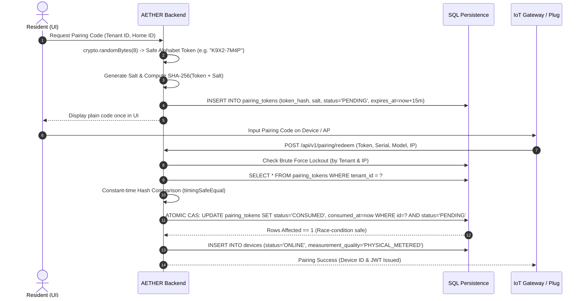

# AETHER Security Threat Model & STRIDE Analysis

## 1. Executive Summary & Security Philosophy
AETHER is an Autonomous Energy & Carbon Neural System managing residential and campus telemetry. The security architecture adheres to three inviolable principles:
1. **Zero Client Trust:** Identity and tenant authorization are derived exclusively from trusted database records on the server; client-supplied tenant context or headers are never trusted.
2. **Zero Secret Leakage:** Artificial Intelligence credentials (`GEMINI_API_KEY`) and billing secrets never touch browser bundles, client logs, or `localStorage`.
3. **Passive Electrical Safety Boundary:** AETHER strictly operates in read-only telemetry mode for residential installations. No automated control commands are permitted to trip physical breakers or mains relays without licensed on-site industrial safety systems.

---

## 2. STRIDE Threat Analysis Matrix

| Threat Category | Potential Attack Vector | Impact | Mitigations Implemented in AETHER |
| :--- | :--- | :---: | :--- |
| **Spoofing (Identity)** | Attacker submits client-side `TenantContext` with another tenant's ID or spoofed token. | High | Server-side identity resolution (`resolveAuthenticatedContext`) validates user session against database table `organization_members`. Database Row-Level Security (RLS) policies enforce SQL-level filtering. |
| **Tampering (Data)** | Malicious insider or compromised process alters historical audit logs or invoice records. | Critical | 1. Database-level immutability triggers (`audit_logs_no_update`, `audit_logs_no_delete`) block all modifications. 2. Cryptographic SHA-256 hash chaining links each record to its ancestor; `verifyIntegrity()` detects any altered bit. |
| **Repudiation** | User denies performing a device revocation or subscription tier change. | Medium | Append-only audit logs record user ID, IP address, timestamp, action, and JSON payload with non-repudiable hash chaining. |
| **Information Disclosure** | 1. LLM API keys exposed in browser bundle. 2. Cross-tenant leakage of residential power profiles. | Critical | 1. Browser-side API key storage (`localStorage`) is completely eliminated; all AI calls route through authenticated server endpoint `handleAiDecisionEndpoint`. 2. SQL queries strictly bind `WHERE tenant_id = ?`. |
| **Denial of Service** | 1. Brute-force guessing of 8-character pairing codes. 2. Telemetry flooding to exhaust DB connections. | High | 1. Pairing tokens stored as salted SHA-256 hashes with 15-minute TTL. 2. Multi-dimensional lockout locks pairing interface for 30 minutes after 5 failed attempts by tenant or IP. 3. Distributed sliding-window rate limiter throttles burst requests across instances. |
| **Elevation of Privilege** | Resident viewer attempts to control or view electrical data of unauthorized building units. | High | Role-Based Access Control (RBAC): `RESIDENT_VIEWER` queries are filtered with explicit `assigned_home_ids` array. |

---

## 3. Cryptographic Ephemeral Pairing Ceremony

---

## 4. AI Gateway & Provider Credential Boundary
- **Environment:** `process.env.GEMINI_API_KEY` is loaded exclusively into server memory.
- **Client Surface:** The client UI contains zero input fields or variables for API keys.
- **Circuit Breaker:** Automatic tripping after 3 consecutive failures with 60-second backoff.
- **Deterministic Fallback:** If the external AI service is unreachable, exhausted, or disabled, `generateHeuristicDecisions()` executes an offline deterministic physics rule engine using EPDK 3-time tariffs and NILM thresholds.

---

## 5. Physical Safety & Regulatory Boundary
- **Certified Electrician Requirement:** `LocalGatewayAdapter` involves installing split-core CT clamps inside main electrical distribution panels. In compliance with the **Turkish Electrical Internal Facilities Regulation (Elektrik İç Tesisleri Yönetmeliği)**, this installation is strictly flagged as non-DIY (`requiresCertifiedElectrician: true`).
- **No Remote Breaker Trips:** To avoid arc flash hazards, equipment damage, or personal injury, AETHER does not issue electrical circuit breaker trip commands over wireless protocols.
